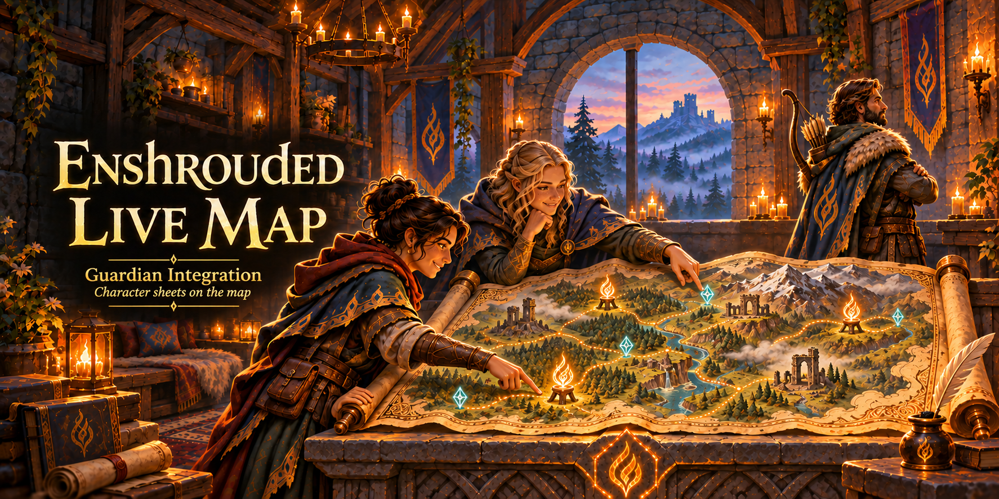

# Enshrouded Live Map



Live browser map for **Enshrouded dedicated servers and locally hosted Windows games**.

The map shows players, world locations, game time, weather, explored areas and world objects.
This maintained version adds persistent online/offline player lists, Guardian character sheets,
localized lore markers and support for local worlds.

Repository: [edtereza/enshrouded-livemap](https://github.com/edtereza/enshrouded-livemap)

Current version: **1.12.1**. See the [changelog](CHANGELOG.md).

## Human and AI contributions

This expanded version is developed with human direction and AI-assisted changes.
The original project and the subsequent maintenance work are credited below.

## Origin and original author

**The original creation of Enshrouded Live Map belongs to oggii.**

This repository builds on oggii's original implementation, including the server-side map,
game-data extraction tools and visual design. The work maintained here extends that foundation
with compatibility updates and the features described in this README.

- Original source code: [oggii/enshrouded-livemap](https://github.com/oggii/enshrouded-livemap).
- Original mod page: [Enshrouded Live Map on Nexus Mods, mod 209](https://www.nexusmods.com/enshrouded/mods/209).

The original `Copyright (c) 2026 oggii` notice and MIT license are preserved in
[LICENSE](LICENSE). The `edtereza` repository is the distribution and maintenance location
for this expanded version.

## Features

- **Live player positions:** names, walking direction, colors and click-to-follow navigation.
- **Unified player list:** online players appear first below the clock. Offline players show
  `offline` in place of coordinates and death information.
- **Persistent player history:** names and available SteamID64 associations are saved in
  `livemap/players.json`.
- **Guardian character sheets:** click the player's colored indicator to open an available
  character report in a full-screen dialog.
- **Included HD map:** switch between `Game map` and `HD` at the bottom left. Both tile sets ship in the main package.
- **World map and search:** region and place names, map markers, Flame Altars, item-source
  searches and links to specific locations.
- **World state:** loaded chests, locks, barriers, switches and nearby creatures, including
  health and boss information where available.
- **Time and weather:** game time, real time, rain, snow and shroud overlays.
- **Exploration and deaths:** explored-area history and persistent death counts.
- **Lore:** 568 placed notes and lore pages with Portuguese and English titles and text.
- **Automatic language:** Portuguese browsers use Português (Brasil). Other or unidentified
  browser languages use English.
- **Configurable access and title:** open browser access by default, an optional access key,
  and a title controlled by `Title=` in `livemap.ini`.
- **Character-sheet loading:** immediate loading feedback, gzip compression, conditional
  revalidation and support for Guardian's versioned shared assets.

## Compatibility

The executable build is checked at startup. The current source recognizes the following builds.

| Mode | Executable | Recognized Steam builds |
| --- | --- | --- |
| Dedicated server | `enshrouded_server.exe` | `25988414`, `26083076`, `26430253` |
| Local world or player-hosted session | `enshrouded.exe` | `26430625` |

Dedicated-server build `26430253` and client build `26430625` correspond to
SVN `1287369`. Local-world player positioning has been checked in a running Windows game.
Dedicated-server startup and HTTP responses have also been checked.

On the November builds, new ore-find detection and live updates to discovered-place knowledge
are unavailable. Saved records remain readable, and explored areas update from player movement.
Lore read/unread progress is not tracked. Four lore markers have no localized body text in the
extracted resources.

Local mode reads the world hosted by that game process. For a remotely hosted world, use the
Livemap supplied by that server. Flame-level lookup through A2S is available in dedicated-server
mode.

Unknown executable builds leave the hooks inactive and record the reason in `livemap.log`.
Wine deployment instructions below follow the upstream loading method; this expanded version
has been checked on Windows.

## Startup console

A Guardian-style figlet `slant` banner prints with `[Livemap]` prefixes and a one-line
version/repository signature. The following loaded message identifies the executable build.
The startup output identifies the mod version and game/server mode.
Startup also reports the required GitHub version check, the HTTP listener and map address,
or the reason the mod could not start. Console notices remain visible with `Log=0`;
periodic position diagnostics stay in `livemap.log`.

## Update notices

Livemap checks the latest stable release in
[edtereza/enshrouded-livemap](https://github.com/edtereza/enshrouded-livemap/releases/latest)
synchronously during mod initialization, before game hooks and the HTTP server start,
and then every 24 hours on a background thread. The startup check is mandatory and
informational: it never blocks use based on version. A newer version is logged once
and announced in the game/server console every hour until restart. Drafts and prereleases
are ignored. If GitHub is unavailable or no release is published, startup continues normally.
No files are downloaded or installed, and no player or server data is sent.

## Dependencies

### Required to run

| Dependency | Purpose |
| --- | --- |
| A recognized Enshrouded Windows x64 executable | Hosts the map-reading hooks. |
| `mods/livemap.dll` with Shroudtopia, or `iphlpapi.dll`; plus `livemap/` | Provide the mod and browser assets. |
| Steam; `EnshroudedWithLivemap.exe` for local proxy mode | Start the local game with the mod. |
| A modern browser | Displays the map. |
| [Guardian](https://github.com/edtereza/enshrouded-guardian), for character reports | Generates the character HTML and its shared assets. |

Dedicated-server players access the map through their browser. Install the mod on the machine
running the server.

### Required to compile

- Visual Studio Build Tools with the MSVC x64/x86 C++ toolchain.
- A Windows SDK providing headers, libraries and resource tools.
- CMake 3.28 or newer, Ninja and Git.
- Network access for CMake to fetch the pinned build dependencies.

CMake resolves SafetyHook `v0.7.0`, its Zydis/Zycore dependencies, and zlib `v1.3.1`.
The mod uses the static C runtime. License notices are included in
[THIRD_PARTY_NOTICES.md](THIRD_PARTY_NOTICES.md).

Python and Node.js are used by optional extraction and browser-test tools. Details of the
game formats and asset-generation tools are in [docs/RESEARCH.md](docs/RESEARCH.md).

## Installation

Versioned packages are generated by GitHub Actions and attached to tagged
[GitHub Releases](https://github.com/edtereza/enshrouded-livemap/releases).
Two ZIP variants follow the Guardian distribution format:

| Package | Contents |
| --- | --- |
| `livemap-{version}.zip` | Livemap, the pinned Shroudtopia loader, clean configuration defaults, both map styles and licenses. Requires Microsoft Visual C++ Redistributable x64 installed separately. |
| `livemap-{version}-full.zip` | The same files plus app-local Microsoft Visual C++ x64 runtime DLLs and their license notice. |

Install one ZIP directly beside the game/server executable. Both include `mods/livemap.dll`,
`shroudtopia.dll`, `winmm.dll`, `shroudtopia.json`, `livemap.ini`, `livemap/` and a
`package-manifest.json` with file hashes. Back up existing DLLs and configuration first;
merge the clean defaults with your existing settings, keeping other enabled mods such as Guardian.
Releases are titled `v{version}` and contain only the standard and full ZIPs.
`SHA256SUMS.txt`, `livemap.dll`, `iphlpapi.dll` and `EnshroudedWithLivemap.exe` remain
available in the [GitHub Actions build artifacts](https://github.com/edtereza/enshrouded-livemap/actions).
The proxy DLL and launcher are kept outside the Shroudtopia ZIPs to avoid loading two copies.
The HD map is included; no separate download is needed. See [HD map credits and instructions](package/README-HD.txt).

### Shroudtopia (client and dedicated server)

1. Stop the game/server and back up existing configuration and mod DLLs.
2. Extract the standard or full ZIP beside the executable. [Shroudtopia](https://github.com/s0t7x/shroudtopia) is included.
3. For an existing installation, merge the packaged configuration into your saved settings. The required `mods` entry is:

```json
{
  "mods": {
    "Livemap": { "active": true }
  }
}
```

Start the game or server normally through Shroudtopia. Keep `livemap.ini`, the web assets
and Guardian reports beside the executable, not inside `mods/`. Look for
`starting via Shroudtopia` in `livemap.log`. Use one loading method: remove Livemap's
`iphlpapi.dll` when using Shroudtopia. The launcher below is for the alternative loading method.

Disable or remove the mod with the game/server stopped. Runtime deactivation or unloading
requires a process restart; existing hooks and workers remain resident until exit.
The Shroudtopia integration is compiled against its native Windows x64 MSVC interface.

For the alternative loading methods below, download the standalone proxy/launcher binaries
from the GitHub Actions artifact and copy only `livemap/` from a release ZIP. Do not install its Shroudtopia DLLs or configuration
when using proxy loading.

### Dedicated server (alternative proxy loading)

1. Stop the dedicated server.
2. Extract `iphlpapi.dll` and `livemap/` beside `enshrouded_server.exe`.
3. Start the server.
4. Read `livemap.log` for the `map link:` entry.
5. Allow TCP traffic on the map port.

With `Port=auto`, the map uses `queryPort` from `enshrouded_server.json` over TCP.
The game uses that port over UDP. If the query port is `15637`, the map address is typically
`http://SERVER_ADDRESS:15637/`.

For Wine, use the upstream proxy override `WINEDLLOVERRIDES=iphlpapi=n,b`.
For Docker, publish the TCP mapping alongside UDP, for example `15637:15637/tcp` and
`15637:15637/udp`.

### Local world or player-hosted session

1. Close the game.
2. Extract `iphlpapi.dll`, `EnshroudedWithLivemap.exe` and `livemap/` beside `enshrouded.exe`.
3. Keep Steam running and start `EnshroudedWithLivemap.exe`.
4. Enter a local world or host a session.
5. Open `http://localhost:15680/`, using your configured `Port` if it differs.

The launcher can also load the mod into an already running game. Loading it before entering
the world allows the mod to observe the world's service registrations.

Fresh local configurations bind to `127.0.0.1` and disable public-IP lookup and chat
announcements. The fallback port is `15680` when no game query port is configured.

### Updating

Stop the game or server before replacing the DLL. Replace the package files while retaining
your `livemap.ini` and generated player-data JSON files. Restart the executable and refresh
the browser with `Ctrl+F5`.

## Configuration

The first run creates `livemap.ini` beside the executable. Configuration changes take effect
after restarting the game or server.

Example for a dedicated server:

```ini
[livemap]
Enabled=1
Title=My Enshrouded Map
Port=auto
Bind=0.0.0.0
PublicUrl=
DetectPublicAddress=1
AnnounceInChat=1
RequireKey=0
UpdateMs=250
```

| Setting | Default | Behavior |
| --- | --- | --- |
| `Enabled` | `1` | Enables the mod. |
| `Title` | `Enshrouded Live Map` | Browser-tab title, reloaded within five seconds. UTF-8 accents are preserved. Empty or missing uses the default. |
| `Port` | `auto` | Uses the configured game query port over TCP, falling back to `15680`. A number selects a fixed port. |
| `Bind` | `0.0.0.0` server, `127.0.0.1` local | Selects the network interface. |
| `PublicUrl` | Empty | Sets the shared address, such as `https://map.example.com`. |
| `DetectPublicAddress` | `1` server, `0` local | Looks up the public address periodically when enabled. Local mode otherwise uses a localhost link. |
| `AnnounceInChat` | `1` server, `0` local | Announces the map link when a player joins. |
| `RequireKey` | `0` | Set to `1` to require an access key. |
| `Key` | Generated on first run | Used when `RequireKey=1`. Use 3–64 letters, digits, `-` or `_`. Comparison is case-insensitive. |
| `UpdateMs` | `250` | Browser update interval, constrained to 100–5000 ms. |
| `Finds` | `1` | Enables supported ore and chest-find hooks. |
| `Bases` | `1` | Enables Flame Altar markers. |
| `Discovered` | `1` | Enables supported discovery updates and explored-area tracking. |
| `Deaths` | `1` | Enables death counting and persistence. |
| `Objects` | `1` | Enables loaded-world chests, switches and creature information. |
| `Log` / `LogDiagnostics` | `1` | Controls the log and periodic diagnostic entries. |

The browser title is determined solely by `Title=` in the `[livemap]` section of
`livemap.ini` beside the executable, or its default. Save the INI as UTF-8 (with or
without BOM) or UTF-16. Title edits appear within five seconds without restarting;
the title is sent with live state as well as inserted into the HTML.

For key-protected access, set `RequireKey=1` and `Key=ourmap`. The resulting link uses
`/?key=ourmap`; the short path `/ourmap` redirects to it.

With open access, anyone who can reach the map address can see the exposed player positions
and available character reports. For HTTPS, configure a reverse proxy and set `PublicUrl`
to its public address.

## Using the map

- **Players:** online and offline entries share one list below the clock. Click an online
  player's name to follow them. Click again or drag the map to stop following.
- **Character sheets:** click the colored indicator beside the name. It is enabled when a
  SteamID association and a generated Guardian sheet are available.
- **Markers:** use the panel to control locations, world objects and overlays.
- **Lore:** click a marker in the notes/lore category to read its text.
- **Language:** interface labels and lore text follow the browser automatically.
- **Search:** find named places, players and item sources.
- **Shared locations:** `?follow=NAME` follows a player and `?mark=X,Z,NAME` marks a location.
  Use `&` to add these parameters to a link that already contains `?key=`.

## Guardian character sheets

Install Guardian on the same server to generate character reports. The current report path is:

```text
guardian/<SteamID>/server_save.html
```

Live Map associates the player's connection handle with SteamID64 records from
`guardian/events.jsonl`, then saves that association with the player's entry in
`livemap/players.json`. Existing offline records without a SteamID need a subsequent
connection to establish the association.

The browser opens `/character?id=<SteamID>`. Older standalone pages under `guardian/` or
`guardiao-dados/` are also supported.

Guardian 3.1.0 generates shared viewer files under `guardian/assets/<version>/`. Live Map
serves the supported CSS, JavaScript, catalogs and images through `/assets/<version>/`,
forwarding the map's access key when enabled. Keep the shared-assets directory alongside
the account directories when moving reports. These files are generated by Guardian.

The dialog opens immediately with loading feedback. Character HTML supports gzip and ETag
revalidation. Versioned shared assets use private immutable caching.

Guardian source and installation instructions are available in the
[Enshrouded Guardian repository](https://github.com/edtereza/enshrouded-guardian).

## Persistent data

Generated data stays under `livemap/` beside the executable.

| File | Contents |
| --- | --- |
| `players.json` | Recorded player names and available `steamId` values. |
| `deaths.json` | Death counts and recent deaths. |
| `explored.json` | Explored-area grids per player. |
| `discovered.json` | Supported discovered-place records. |
| `finds.json` | Previously recorded ore and chest finds. |
| `objects.json` | Last observed chest and lock/switch states. |

The mod also imports names from existing Livemap logs and saved records. On the first startup
after upgrading, existing `player-accounts.json` associations can be imported into
`players.json`.

## Builds and releases

The [GitHub Actions workflow](.github/workflows/build.yml) compiles, runs the C++ tests and
packages the project on pushes, pull requests and manual runs. Downloadable ZIPs are stored
as workflow artifacts.

To publish a release, set the version in `CMakeLists.txt` and the package README, then push
the corresponding tag, for example `v1.12.1`. The workflow checks that the tag matches the
project version before creating the GitHub Release.

Local compilation is available through `build.cmd`, which locates the installed Visual
Studio C++ tools and produces the binaries under `build/`. `package.cmd` builds, tests and
uses `scripts/package.ps1` to verify standard/full packages under `dist/distribution/`.
Distribution packaging runs only in GitHub Actions. Both ZIPs include the original and HD tiles.
The full package adds only Visual Studio x64 VC/Redist CRT DLLs, never Windows system DLLs.
The pinned Shroudtopia 0.1.1 binaries are verified by SHA-256; their provenance and license
are in [dependencies/shroudtopia](dependencies/shroudtopia/README.md). The offline diagnostic tool can check hook sites:

```text
build\livemap_selftest.exe "C:\path\to\enshrouded_server.exe"
```

Build outputs, downloaded dependencies, local configuration and player data are ignored by Git.
Technical research and extraction references are in [docs/RESEARCH.md](docs/RESEARCH.md).

## Credits and license

- **oggii:** original Enshrouded Live Map, its foundational implementation and original visual design.
- **Keen Games:** Enshrouded and the game-derived map, UI and icon artwork.
- **Nicolas Ferreira and Guardian contributors:** the character-management project behind the
  optional Guardian report integration.
- **SafetyHook, Zydis, Zycore, zlib and Alegreya contributors:** libraries and typography used
  by the project, with notices in [THIRD_PARTY_NOTICES.md](THIRD_PARTY_NOTICES.md).

The original project is licensed under the [MIT license](LICENSE), whose original copyright
notice remains included.
